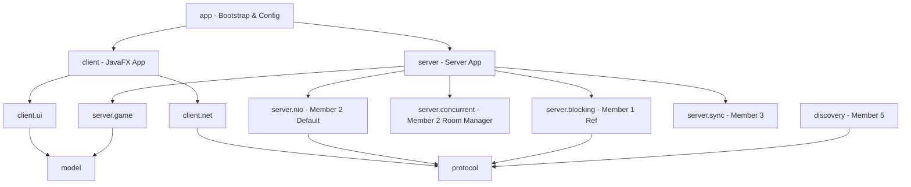

# QuizBattle 2.0 System Architecture

## 1. Architectural Goals & Design Principles

QuizBattle 2.0 is designed as a modular, concurrent, distributed system adhering to clean-architecture principles:

1. **Separation of Concerns**: Network transport (I/O) is completely detached from business logic (scoring, room lobbies, trivia rules) and presentation (JavaFX).
2. **Pluggable Transports**: Both Non-blocking (`java.nio.channels.Selector`) and Blocking (`java.net.ServerSocket`) implementations bind to the same transport-neutral `ServerMessageDispatcher`. The non-blocking Java NIO engine is the default production server.
3. **Thread Safety & Lock Granularity**: Room lobbies and player rosters use fine-grained concurrent collections (`ConcurrentHashMap`) with per-room locks (`ReentrantLock`) rather than crude global locks.
4. **Authoritative Server Security**:
   - The client is **untrusted**. Clients NEVER supply authoritative identifiers (such as self-assigned `playerId`, `score`, or host flags).
   - The server associates each physical socket/channel with a secure `ClientSession`.
   - On handshake (`CONNECT`), the server issues or confirms the `playerId` and binds it to that session.
   - All subsequent game mutations are validated against the calling session context.
5. **UI Thread Integrity**: JavaFX UI controls are exclusively modified on the JavaFX Application Thread. The client network abstraction guarantees that all callbacks arrive via `UiCallbackDispatcher` (`Platform.runLater()`).

---

## 2. Package Organization & Dependency Graph

### Dependency Rules:
- `protocol` and `model` are leaf dependencies: they have zero dependencies on `client`, `server`, or `ui`.
- `client.ui` communicates with `client.net` strictly through the `NetworkClient` interface.
- `server.nio` and `server.blocking` communicate with the game engine strictly through `ServerMessageDispatcher` and `ClientSession`.
- **Zero Circular Dependencies**: Cyclic package imports are strictly prohibited.

---

## 3. Server Architecture: Java NIO Non-Blocking Engine

### 3.1 Non-Blocking I/O Multiplexing (`server.nio`)
The default server engine is `NioQuizServer`, implementing a single-threaded selector event loop serving hundreds of concurrent connections without thread-per-client overhead:

1. **ServerSocketChannel & Selector**:
   - `ServerSocketChannel` binds to TCP port `5000` (or dynamic ephemeral port for tests).
   - Configured non-blocking and registered with `Selector` for `OP_ACCEPT`.
2. **OP_ACCEPT Event Handling**:
   - Accepts incoming `SocketChannel`, configures non-blocking and `TCP_NODELAY`.
   - Creates a server-authoritative `NioClientSession` and attaches it to the `SelectionKey`.
   - Registers for `OP_READ`.
3. **OP_READ Event Handling & Stream Framing**:
   - Reads incoming data into a reusable `ByteBuffer`.
   - Passes bytes to `StreamFrameAccumulator` in `NioClientSession`.
   - Assembles newline-delimited (`\n`) JSON frames up to 64 KiB cap.
   - Handles partial reads, multi-message packets, and split UTF-8 sequences.
   - Dispatches parsed messages onto an asynchronous `workerPool` (`quizbattle-nio-worker`) so game logic never blocks the selector thread!
4. **OP_WRITE Event Handling & Outbound Queues**:
   - Each `NioClientSession` maintains a bounded outbound message queue (`ConcurrentLinkedQueue<ByteBuffer>`).
   - When outbound messages are queued, the session registers `OP_WRITE` interest via `server.requestWrite(session)` and calls `selector.wakeup()`.
   - In `handleWrite()`, the selector flushes ByteBuffers to `SocketChannel.write()`.
   - If a partial write occurs (socket send buffer full), unsent bytes remain in `currentOutgoingBuffer` and `OP_WRITE` remains active.
   - When the queue is fully drained, `OP_WRITE` is cleared immediately to prevent busy-spinning!

### 3.2 Thread-Safe Worker & Scheduler Decoupling
- Network I/O is isolated to the NIO selector thread.
- Incoming messages are dispatched via `workerPool`.
- Per-session message ordering is preserved using synchronized dispatch locks.
- Future Member 3 background scheduler threads submit events through thread-safe `server.submitTask(Runnable)` and `session.send(Message)` with `selector.wakeup()`.

---

## 4. Multiplayer Room Management Architecture (`server.concurrent`)

### 4.1 Concurrent Room Manager (`ConcurrentRoomManager`)
- **Server-Authoritative Room Codes**: Unique 6-character alphanumeric uppercase codes (e.g. `QB42KD`).
- **Fine-Grained Concurrency**: Per-room `ReentrantLock` instances ensure mutations in Room A never block operations in Room B.
- **Dynamic Host Migration**: When a host departs or disconnects, the server automatically promotes the next remaining participant to Host and broadcasts updated `ROOM_STATE`.
- **Automatic Lifecycle Cleanup**: When all participants leave an ephemeral room, the room is safely de-registered and resources are released.
- **Room Isolation**: Messages, question deliveries, and room states are strictly scoped to sessions whose `currentRoomId` matches the target room.

---

## 5. Client JavaFX UI Architecture

- **Navigation Container (`NavigationContainer`)**: Root container managing top bar, live connection status indicator, back stack, and scene transitions.
- **Screen 1 — Host Dashboard (`HostDashboardView`)**: Displays player alias, TCP connection badge, "Create Room", "Join Room by Code", "Quick Play (Default Room)", and "Disconnect".
- **Screen 2 — Create Room Confirmation (`CreateRoomView`)**: Shows authoritative room code, "Copy Room Code" action, host status, and navigation to lobby.
- **Screen 3 — Join Room (`JoinRoomView`)**: Input field with auto-uppercase formatting, room code validation, loading spinner, and structured error reporting.
- **Screen 4 — Multiplayer Lobby (`MultiplayerLobbyView`)**: Live synchronized roster, player count counter, host status indicator, "Leave Room" trigger, and host-only "Start Quiz" button.
- **Screen 5 — Player Home & Quiz Arena (`PlayerHomeView`)**: Active trivia question display, multiple-choice buttons (A, B, C, D), answer feedback banner, and score counter.
- **UI Thread Safety (`UiCallbackDispatcher`)**: All socket callbacks invoke `Platform.runLater()` to maintain UI thread integrity and handle headless testing gracefully.
