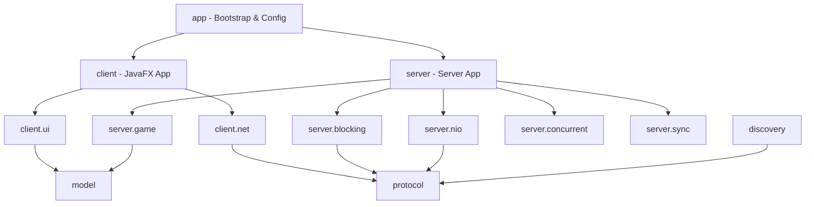

# QuizBattle 2.0 System Architecture

## 1. Architectural Goals & Design Principles

QuizBattle 2.0 is designed as a modular, concurrent, distributed system adhering to core clean-architecture principles:

1. **Separation of Concerns**: Network transport (I/O) is completely detached from business logic (scoring, room lobbies, trivia rules) and presentation (JavaFX).
2. **Pluggable Transports**: Both Blocking (`java.net.ServerSocket`) and Non-blocking (`java.nio.channels.Selector`) implementations bind to the same transport-neutral `ServerMessageDispatcher`.
3. **Thread Safety & Lock Granularity**: Room registries and player rosters use fine-grained concurrent collections (`ConcurrentHashMap`) or explicit state synchronizers rather than crude global locks.
4. **Authoritative Server Security**:
   - The client is **untrusted**. Clients NEVER supply authoritative identifiers (such as self-assigned `playerId` or `score`).
   - The server associates each physical socket/channel with a secure `ClientSession`.
   - On handshake (`CONNECT`), the server issues or confirms the `playerId` and binds it to that session.
   - All subsequent game mutations are validated against the calling session context.
5. **UI Thread Integrity**: JavaFX UI controls are exclusively modified on the JavaFX Application Thread. The client network abstraction guarantees that all callbacks arrive via `UiCallbackDispatcher` (`Platform.runLater()`).

---

## 2. Package Organization & Dependency Rules

### Dependency Rules:
- `protocol` and `model` are leaf dependencies: they have no dependencies on `client`, `server`, or `ui`.
- `client.ui` communicates with `client.net` strictly through the `NetworkClient` interface.
- `server.blocking` and `server.nio` communicate with the game engine strictly through `ServerMessageDispatcher` and `ClientSession`.
- **Zero Circular Dependencies**: Cyclic package imports are strictly prohibited.

---

## 3. Server Architecture

### 3.1 Session Management
Each connected client has an active `ClientSession` instance encapsulating:
- Socket/Channel reference
- Session ID (UUID)
- Authenticated `playerId` and `username`
- Associated `roomId` (if currently in a lobby or active match)
- Send queue / write buffer

### 3.2 Dispatcher Layer (`ServerMessageDispatcher`)
When a complete newline-terminated JSON message arrives from a socket:
1. It is decoded into a `Message` object by `MessageCodec`.
2. The dispatcher inspects `Message.getType()`.
3. If an error occurs (e.g. malformed JSON or message exceeding 64 KiB), the server returns an `ERROR` message with the corresponding `requestId`.
4. The dispatcher invokes the registered handler `(session, message) -> ...`.

### 3.3 Blocking vs NIO Engines
- **Blocking (`server.blocking`) - Member 1**:
  - One thread per client connection.
  - Blocking reads on `BufferedReader` or `InputStream` until `\n`.
  - Simple, robust baseline implementation.
- **NIO Multiplexing (`server.nio`) - Member 4**:
  - Single selector thread managing hundreds of `SocketChannel` instances without thread-per-client overhead.
  - Channels register for `OP_READ` and `OP_WRITE`.
  - Non-blocking frame accumulator assembling partial chunks into complete JSON lines.

---

## 4. Client Architecture

### 4.1 JavaFX UI Architecture
- **Root Container**: `NavigationContainer` provides persistent top app bar, live connection indicator, and view stack for seamless navigation.
- **Views**: Clean decoupled views (e.g. `WelcomeView`, and upcoming `LobbyView`, `QuizArenaView`, `LeaderboardView`).
- **Styling**: Central stylesheet `resources/styles/app.css` using modern dark mode colors (Slate, Sky, Indigo).

### 4.2 Network Client Threading
- Network I/O runs entirely on background daemon threads.
- Inbound messages from the TCP socket are decoded by `MessageCodec` and dispatched to registered UI listeners.
- `UiCallbackDispatcher` wraps all callback executions in `Platform.runLater()`, preventing `IllegalStateException: Not on FX application thread`.
